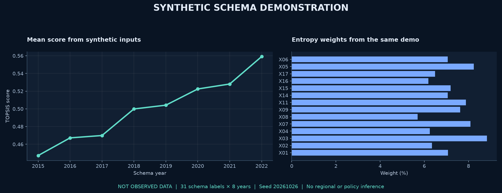

# 乡村振兴研究代码与复现工作台

面向 2015–2022 年、31 个省级统计单元的乡村振兴指标分析工程。保留 **21 个原研究脚本、6 个历史结果工作簿、16 张历史图表**，新增隔离运行入口、固定种子合成面板和可检查的运行记录。

**状态：原研究档案整理版；基础与扩展脚本已完成软件运行检查。历史论文结果未被完整复原，统计结论未经本次重新认证。**

[浏览合成示例](https://yangwei251003.github.io/rural-revitalization-research/) · [数据及图表权限](DATA_LICENSES.md) · [复核结果与局限](docs/VALIDATION.md) · [更新记录](CHANGELOG.md)



> 图中全部数值由固定随机种子生成。省份名称只用于匹配旧脚本结构；它不是国家统计局观测数据，不能用于地区排名、政策判断或论文结论。

## 工程内容

- 熵权 TOPSIS：方向处理、熵权计算、综合得分及维度得分。
- 时空描述：年度变化、区域比较、分布描述与 Dagum 基尼分解。
- 扩展研究：面板回归、稳健性与异质性、空间模型、收敛性及障碍度分析。
- 证据归档：保留原有结果与不同版本，记录无法复原的差异，而非选择性删除负结果。
- 论文辅助：保留文档、公式、表格与图形生成源码；私人原稿、比赛材料与第三方比对报告不公开。


## 技术栈

Python 3.12；核心依赖 NumPy、pandas、OpenPyXL、Matplotlib、Seaborn、SciPy。扩展研究使用 statsmodels、linearmodels、libpysal、spreg；文档辅助使用 python-docx、lxml。依赖版本分别锁定在核心与完整清单中，依赖不随仓库打包。

## 五分钟运行合成示例

需要 Python 3.12 与联网安装依赖；无需账号、模型 API、数据库或硬件。

```sh
git clone https://github.com/yangwei251003/rural-revitalization-research.git
cd rural-revitalization-research
python -m venv .venv
```

Windows PowerShell：

```powershell
.venv\Scripts\python.exe -m pip install -r requirements.txt
.venv\Scripts\python.exe tools/run_analysis.py --demo --out runs/demo
.venv\Scripts\python.exe tools/render_demo.py --run runs/demo --out runs/demo-preview
```

macOS / Linux（本次未实测这些平台）：

```sh
.venv/bin/python -m pip install -r requirements.txt
.venv/bin/python tools/run_analysis.py --demo --out runs/demo
.venv/bin/python tools/render_demo.py --run runs/demo --out runs/demo-preview
```

默认执行 Step 1–3。查看 `runs/demo/run-manifest.json`、`logs/`、生成的 Excel 及 `runs/demo-preview/demo-summary.png`。输出必须是**新建或空目录**；再次运行请换一个目录名，以保留前次证据。旧脚本本身生成的图片标题保留原样，合成运行下同样只是合成结果，不得当作真实统计图发表。

### 扩展全部分析

```powershell
.venv\Scripts\python.exe -m pip install -r requirements-full-lock.txt
.venv\Scripts\python.exe tools/run_analysis.py --demo --out runs/demo-full --steps all
```

`all` 顺序执行 1、2、3、4、5、6、7a、7b、8、9、10 共 11 个分析脚本。本次 Windows / Python 3.12 环境中全部退出 0；这不表示每个模型适合任意输入，也不表示脚本打印的显著性或稳健性文字自动成立。日志与模型警告应一起阅读。

### 使用自备数据

```powershell
.venv\Scripts\python.exe tools/run_analysis.py --panel "path/to/your-panel.xlsx" --out runs/own-data
```

需自行取得有权使用的面板，前两列为 `省份`、`年份`，其余列名与 `analysis/legacy/step1_entropy_topsis.py` 中 `positive` / `negative` 清单一致。可先运行 `tools/make_demo_panel.py --out schema-example.xlsx` 检查结构。源码包含原始表格拼接脚本，但本仓库不附原统计表；不能只凭本仓库恢复原始观测面板。

## 目录

```text
analysis/legacy/       21 个研究及文档辅助脚本
historical-results/    6 个原历史工作簿及 16 张原历史图表
/tools/               合成面板、隔离执行、标注演示图
/docs/images/          当前合成计算图和工作流示意图
/docs/preview/         Pages 静态演示入口
/docs/VALIDATION.md    运行检查、差异与方法局限
requirements*.txt     核心 / 完整依赖锁定
DATA_LICENSES.md       原始数据、原图、合成数据的权利边界
```

## 需要先读的研究边界

1. **归档结果未完整复原。** 当前脚本与归档 Step 1–3 工作簿结构不同；对齐 248 个省份—年份后，TOPSIS 综合得分全部不同，最大绝对差约 0.3200。保留两套证据，不能称复现成功。
2. **回归不等于因果。** Step 4 以构成综合得分的指标回归该得分，存在构造性关联；高拟合度不能证明政策因果效果。
3. **数据存在填补。** 拼接源码将部分后续年份沿用较早年份，文化支出占比也有固定年份 / 全国均值填补。详见复核记录。
4. **空间权重需重新核验。** 所谓 Queen 权重由人工枚举，含海南—广东连接；本次未用地理边界重新验证。
5. **历史绘图与修订稿脚本含固定结果。** `generate_figures_all.py`、`generate_revised_paper.py` 等保留原数值，并非输入任意面板后自动重新估计的完整链条。
6. **三张空间分布图未发布。** 它们包含面板没有的港澳台得分且未找到相应数据链与底图来源；其余历史图仍按历史档案看待。

## 在线预览与后续计划

GitHub Pages 只展示**预先计算的合成示例和项目说明**；不会运行 Python、接收数据或执行回归。本地命令才是计算入口。部署由 `.github/workflows/pages.yml` 完成。

后续应先核对每个原始指标来源与授权、恢复修订版完整生成链、重建空间权重，并由独立研究审查方法与统计解释。本仓库没有把这些未完成事项包装成完成。

原创代码和新增文档采用 MIT；第三方依赖、国家统计局资料与历史数据衍生内容保留各自权利，详见 `DATA_LICENSES.md`。原始压缩包还含未公开的原表、原稿与受限材料，因此**本仓库不是原项目的全量备份，原项目暂不可据此删除**。
